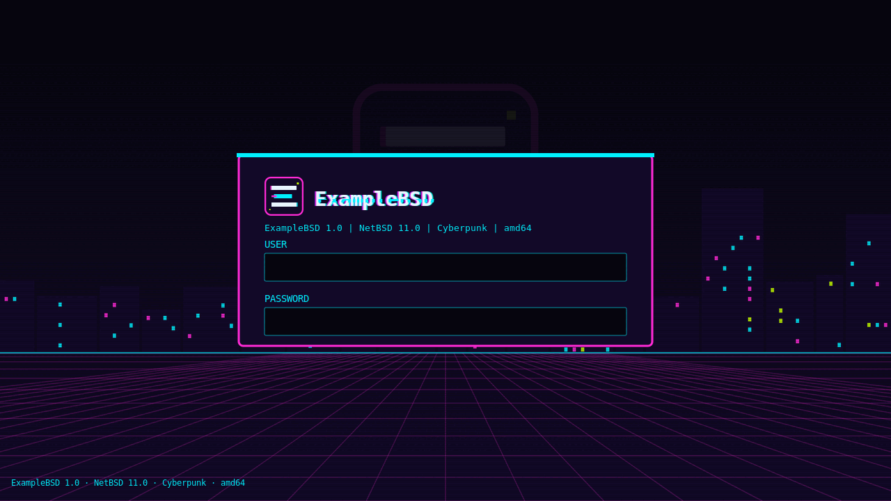
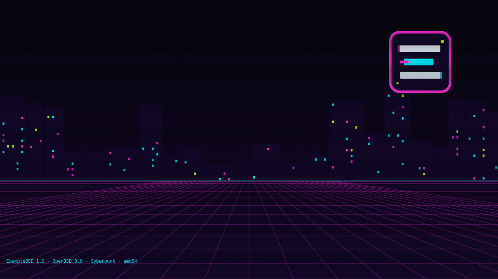
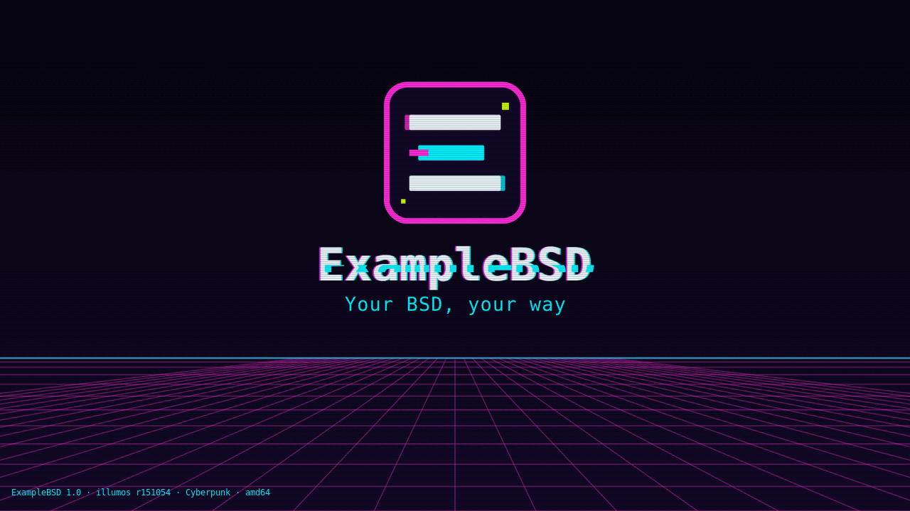

# ExampleBSD — BSD Artwork & Branding Template

A generic, rebrandable **artwork and branding pack** for the
[wtfbsd](https://github.com/wtfbsd) family of BSD desktop templates
(FreeBSD, NetBSD, OpenBSD, DragonFly, illumos). From one palette it renders
logos, boot loader art, boot splashes, the login screen for every display
manager the templates use (LightDM, xenodm, SLiM, xdm), installer art,
wallpapers, icons and the X11/Xfce configuration.

The desktop target is **X11 + Xfce**. The pack ships with the placeholder
name **ExampleBSD**; the name, colours and look are yours to change.

| Default | Cyberpunk |
|---|---|
|  |  |
|  |  |
| |  |

The line in the lower-left corner of each picture is the
[identity line](#identity-line): product, version, base OS, variant and
architecture.

## Quick start

```sh
sh scripts/render.sh                          # default variant into out/
sh scripts/render.sh --variant cyberpunk      # the cyberpunk variant
sh scripts/rebrand.sh "My OS" 4488CC 26B67C   # new name and colours, re-render
sh scripts/pack.sh                            # pre-rendered packs into dist/
sh tests/test-render.sh && sh tests/test-branding.sh &&
    sh tests/test-pack.sh && sh tests/test-portability.sh
```

## Where the branding goes

[BRANDING-SPOTS.md](BRANDING-SPOTS.md) lists every place a product shows its
branding: boot menu brand and logo, boot splash, motd and login banner, each
display manager's logo, colours and background, installer header, sidebar
and title, wallpapers, icons, Xfce theme, favicon and the identity line. For
each it gives the install path on FreeBSD, NetBSD, OpenBSD, DragonFly and
illumos (or why the OS has no such spot), the size and format, and the source
file here. [`branding/spots.tsv`](branding/spots.tsv) is the same list for
templates to install from.

## Variants

A variant is a named look: a palette and art that differ from the base.

```
variants/default/palette.env      VARIANT_LABEL only: the base look
variants/cyberpunk/palette.env    neon colours, monospace font
variants/cyberpunk/src/*.svg      the cyberpunk art
```

`variants/<name>/palette.env` sets only the keys that differ from
`palette.env`. Any other file in `variants/<name>/` replaces the base file at
the same path. A product picks a variant with `ARTWORK_VARIANT` in
product.conf; `render.sh` and `rebrand.sh` take `--variant NAME` or read
`ARTWORK_VARIANT` from the environment.

To add a variant, create `variants/<name>/palette.env` with `VARIANT_LABEL`
and the keys you change, then add only the SVGs you redraw.

## Identity line

A small line in the lower-left corner of the installer, the greeter and the
desktop:

```
ExampleBSD 1.0 · FreeBSD 16.0-CURRENT · Cyberpunk · amd64
```

The product build writes it once, from the built system, to
`/usr/local/share/<slug>/identity`, and renders with it:

```sh
sh scripts/identity-file.sh --product ExampleBSD --version 1.0 \
    --base "FreeBSD 16.0-CURRENT" --variant Cyberpunk --arch amd64 > identity
sh scripts/render.sh --variant cyberpunk --identity identity
```

`render.sh --identity` stamps the line on the greeter, SLiM and wallpaper
backgrounds and writes it into the xenodm, xdm and SLiM configs.
`scripts/identity-stamp.sh` stamps any other image (an installer backdrop).
The stamp keeps a contrast of at least 4.5:1, adding a plate behind the text
when the background needs one. Details are in
[BRANDING-SPOTS.md](BRANDING-SPOTS.md#identity-line).

## Palette

`palette.env` is a POSIX shell `KEY=VALUE` file and the one place branding
lives. Values may not contain `#`; colours are written without it.

```sh
NAME="ExampleBSD"
NAME_LOWER="examplebsd"
TAGLINE="Your BSD, your way"
PRIMARY=2F6FDE
ACCENT=21B8A6
HIGHLIGHT=F2B33D
DARK=14182B
DARK2=1E2440
LIGHT=F4F6FB
MUTED=8A93B2
IDENTITY_FG=A3ABC8
FONT="DejaVu Sans"
```

Templates use these as `@NAME@`, `@PRIMARY@` and so on. `render.sh` also
provides `@VARIANT@`, `@VARIANT_LABEL@`, `@SHARE_DIR@` (the install
directory, `/usr/local/share/<slug>` unless `--share-dir` says otherwise),
`@IDENTITY_LINE@` and `@IDENTITY_ASCII@`. A file name containing
`@NAME_LOWER@` is renamed with the slug, and the token itself expands to
`<slug>`. Nothing in `src/` or the config templates names the product or
its colours directly.

## Rebranding

1. Edit `palette.env` (and `variants/<name>/palette.env` for colours a
   variant sets itself), then run `sh scripts/render.sh`; or
2. run `sh scripts/rebrand.sh [--variant NAME] NewName [PRIMARY [ACCENT]]`.
   The name goes to `palette.env`; each colour goes to the variant's palette
   if the variant sets that key, otherwise to `palette.env`. It never
   touches `src/`.

## Output

```
out/
├── variant      the variant rendered
├── identity     the identity file (with --identity)
├── logo/        logo-{64,128,256,512}.png, wordmark.png, wordmark-light.png
├── splash/      splash-640x480.png, splash-1024x768.png, splash-1920x1080.png
├── loader/      splash.png, <slug>-brand.png, <slug>-logo.png, loader-logo.png
├── boot/        freebsd/ (gfx-<slug>.lua, loader.conf.fragment), illumos/,
│                netbsd/boot.cfg, dragonfly/dloader.menu
├── console/     motd.template, gettytab.fragment, issue
├── installer/   header.png, sidebar.png
├── lightdm/     greeter-1920x1080.png, lightdm-gtk-greeter.conf, greeter-gtk.css
├── dm/          pixmaps/<slug>-{color,8bpp,1bpp}.xpm, xenodm/, xdm/, slim/<slug>/
├── wallpapers/  wallpaper-N-1920x1080.png, wallpaper-N-3840x2160.png (N=1..3)
├── icons/       hicolor/{sizes}/apps/<slug>-{logo,installer,menu}.png + scalable/
├── favicon/     favicon-{16,32,48,180,192,512}.png, favicon.svg, favicon.ico
├── xfce/        gtk-colors.css, xfwm4-themerc, xfconf/*.xml, autostart/,
│                session/
└── xinit/       xinitrc.example
```

`xfce/autostart/*.desktop` installs to `/etc/xdg/autostart/`.
`xfce/session/*.sh` installs to the share directory the autostart `Exec`
line names: `/usr/local/share/<slug>/xfce/session/`. In the templates
`@SHARE_DIR@` expands to `/usr/local/share/<slug>` and `@NAME_LOWER@` to
the product slug (`<slug>`); the session helper is installed root-owned,
mode 0755.

The session helper `xfce/session/<slug>-wallpaper.sh` fills in the packaged
wallpaper on every display output that has no wallpaper yet; an output whose
wallpaper the person chose is left alone.

The loader brand, logo and splash are 8-bit RGBA PNGs: FreeBSD's vt(4) draws
only RGBA splashes.

## Pre-rendered packs

Build hosts do not need the renderer. `sh scripts/pack.sh` renders every
variant and writes `dist/<slug>-<commit>-<variant>.tar.xz` and a `.sha256`
for each. A pack holds `out/`, `branding/spots.tsv`, `BRANDING-SPOTS.md`,
the palettes and the identity scripts, so a template can pin a commit, fetch
the pack, check its sha256 and install from it. Stamping the identity line
from a pack needs ImageMagick only. Rendering locally remains the fallback.

## Requirements

- **rsvg-convert** (librsvg), **inkscape** or **cairosvg**: SVG to PNG.
- **ImageMagick** (`magick` or `convert`): XPM logos, RGBA loader images,
  `favicon.ico`, the identity stamp.
- **fontconfig** (`fc-match`) and the **DejaVu** fonts (Sans and Sans Mono),
  the only fonts the art uses.
- **xz** and **sha256sum** or **sha256**: `pack.sh`.
- **python3**: the tests read PNG headers with it.

## Style rules

- Fonts: DejaVu Sans and DejaVu Sans Mono only.
- All art is original vector drawing: no embedded rasters, no external
  references, no third-party logos.
- The mark is an abstract "E" of three bars. It must not resemble any BSD
  logo or mascot: no daemon, horns, pitchfork, flag, pufferfish, dragonfly or
  insect, sun or flame.
- No display-manager config names an OS logo; the login screens show the
  product's.

## Tests

| Suite | Checks |
|---|---|
| `tests/test-render.sh` | every PNG at its size; no `@TOKEN@` left; rebrand renames everything |
| `tests/test-branding.sh` | both variants render every asset and differ; overrides are real; every display-manager asset exists, uses the variant's palette and the product logo; `spots.tsv` is well formed and every source and rendered path exists; rebrand reaches every display-manager asset; the identity line fits on one line at 1024 px and keeps 4.5:1 contrast (measured in the test), and is refused below it; README and previews |
| `tests/test-pack.sh` | one verified pack per variant, with everything a template installs |
| `tests/test-portability.sh` | no GNU-only `grep`, `sed` or shell constructs |

To try the scripts with non-GNU tools, put busybox `grep`, `sed` and `awk`
first on `PATH` and run the suites again. `sh scripts/previews.sh`
regenerates the pictures above.

## License

BSD-2-Clause. See [LICENSE](LICENSE).
